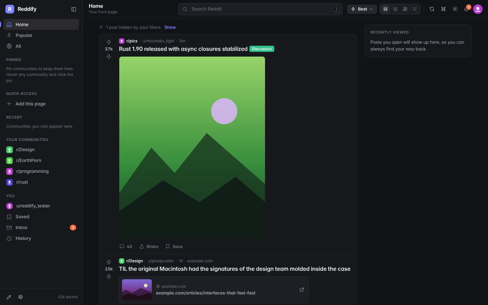
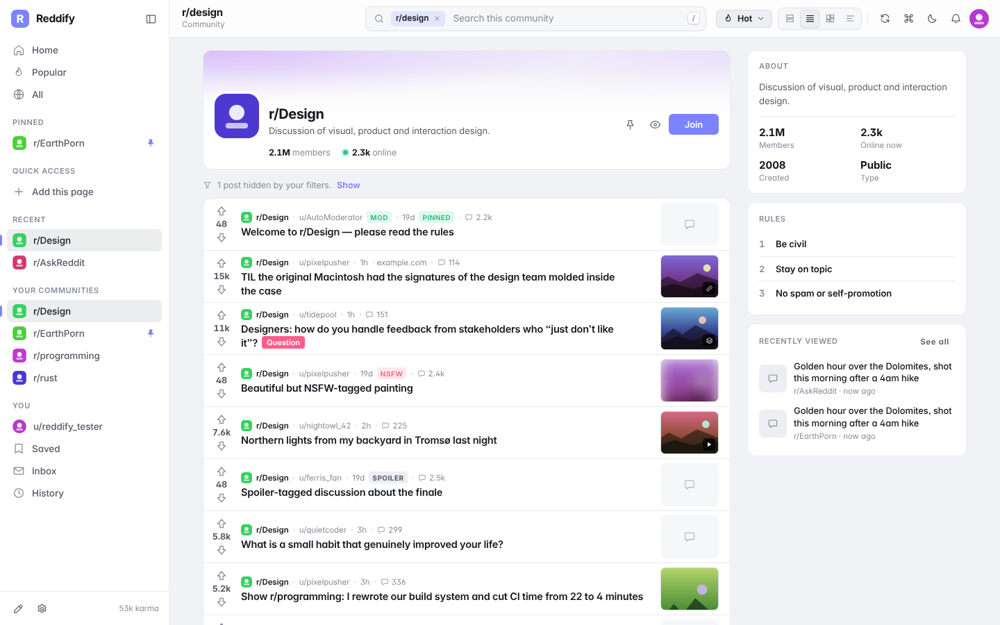
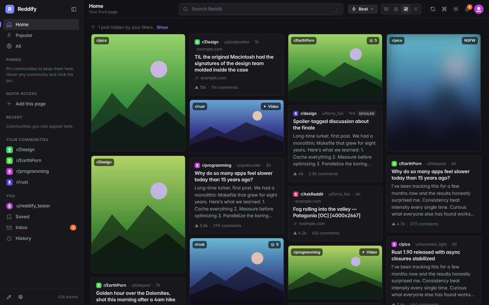
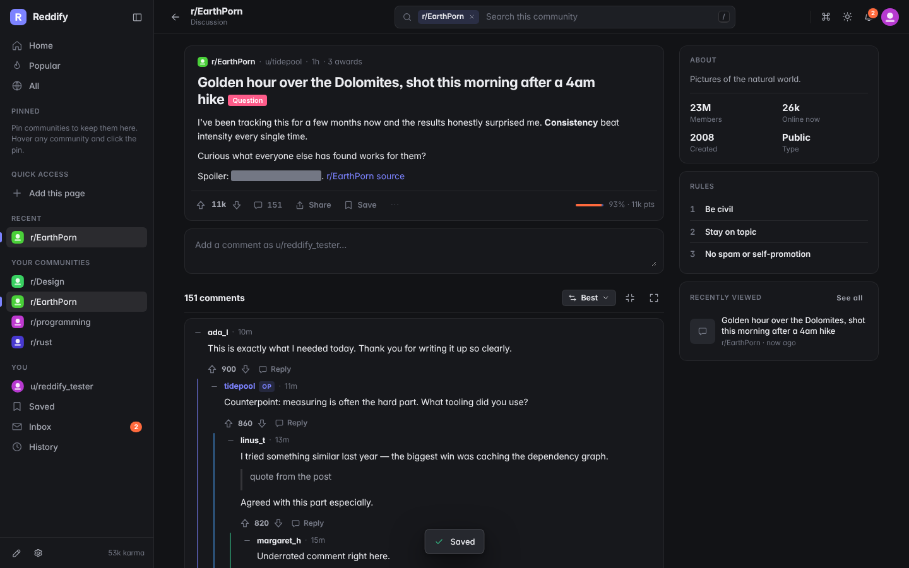
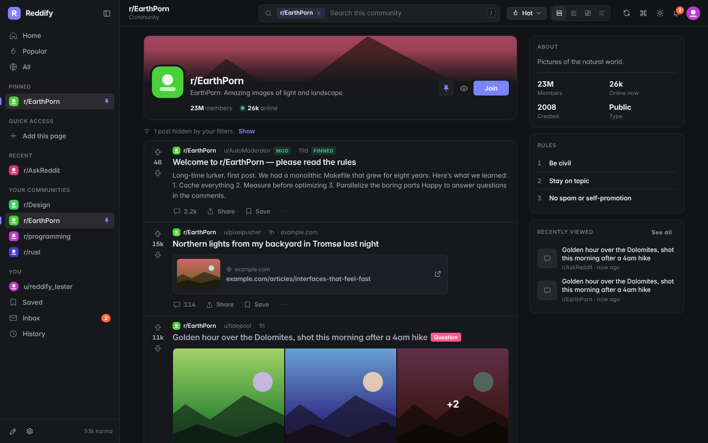
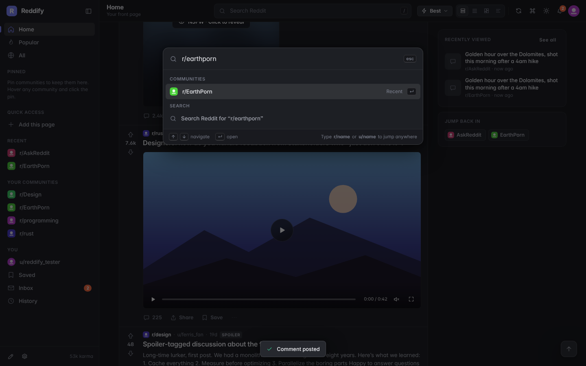

# Reddify

**A premium, keyboard-first redesign of Reddit — built as a Chrome extension.**

Reddify replaces Reddit's interface with a fast, dark-first reading app: a customizable sidebar, four feed layouts, threaded comments that are actually easy to follow, an immersive media viewer, a command palette, and deep personalization. It runs entirely in your browser on top of Reddit's own data and your existing login. There's no server and no account to create.

| Comfortable | Compact (light) |
|---|---|
|  |  |
| **Gallery** | **Post & comments** |
|  |  |
| **Community** | **Quick switcher (⌘/Ctrl K)** |
|  |  |

---

## Install

### Option A — load the prebuilt extension (fastest)

1. Download or clone this repository.
2. Open `chrome://extensions` in Chrome (or any Chromium browser: Edge, Brave, Arc).
3. Turn on **Developer mode** (top-right).
4. Click **Load unpacked** and select the **`dist/`** folder.
5. Open [reddit.com](https://www.reddit.com). The settings page opens automatically on first install.

You can also unzip `release/reddify-1.0.0.zip` and load that folder the same way.

### Option B — build from source

Requires Node.js 18+.

```bash
npm install
```

```bash
npm run build
```

Then load `dist/` as described above. Use `npm run dev` to rebuild automatically while editing, then click the reload icon on the Reddify card in `chrome://extensions`.

## Updating

- **From source:** `git pull`, then `npm install` and `npm run build`, then click **reload** (↻) on the Reddify card in `chrome://extensions` and refresh open Reddit tabs.
- **From a zip:** replace the folder you loaded with the new one and click **reload** in `chrome://extensions`.

Your settings live in Chrome's synced storage and your history lives in local storage. Both survive updates and reloads.

---

## Features

### Interface
- **Collapsible sidebar** with Home, Popular and All, plus pinned communities, quick-access links, recent communities, your joined communities, and your profile, Saved, Inbox (with unread count) and History. Sections can be **reordered, hidden and shown** (pencil button, or Settings → Sidebar). Supports **expanded** and **compact (icon-only)** modes with adjustable width.
- **Top bar**: current feed title, integrated **search with live community suggestions** (automatically scoped to the community you're in, and Backspace clears the scope), sort menu with time ranges, layout switcher, refresh, theme toggle, inbox bell with badge, and an account menu.
- **Four feed layouts**: *Comfortable* (rich previews), *Compact* (dense rows with thumbnails), *Gallery* (balanced masonry for images and video), and *Minimal* (one line per post).
- **Post cards** show community identity, author, age, flair, NSFW/spoiler/locked/pinned tags, link domain, text preview, image/gallery/video/embed/link previews, voting, comment count, share, save, and a "more" menu (copy link, open in new tab, open the original link, view media, hide, mute community).
- **Right panel**: community about, stats and rules on community and post pages; recently viewed posts and quick jumps elsewhere.
- **Dark and light themes** (plus *System*), with a refined token-based design system and a customizable accent color.

### Reading
- **Comment threads** with depth-colored guide lines (click a line to collapse that whole thread), collapsed summaries ("12 replies"), OP, mod and admin badges, flair, "load more" and "continue this thread", plus **collapse all / expand all** and a sticky comment toolbar with sort options (Best, Top, New, Controversial, Old, Q&A).
- **Reply and comment** inline (Markdown supported, ⌘/Ctrl+Enter to send).
- **Immersive media**: a lightbox with zoom (wheel, double-click, +/−), drag-to-pan, gallery navigation with thumbnails and captions, and a **custom video player** that plays Reddit's split video and audio streams together, with a theater view. Gallery carousel on post pages.
- **Reading mode**, adjustable **content width, text size, line spacing and density**, and compact media previews.
- Spoiler text and NSFW/spoiler media stay hidden until you click.

### Productivity
- **Keyboard shortcuts for everything**: press `?` in the app to see them all (also listed below).
- **Quick switcher / command palette** (`⌘/Ctrl K`): jump to any community (`r/name`) or user (`u/name`), recent posts, quick links, layouts, sorts, theme, settings and more.
- **History**: recently viewed posts and communities (stored on your device only), with dimming of posts you've already opened.
- **Quick access**: pin any Reddit page (a search, a multireddit, a profile) to the sidebar.
- **Saved posts organization**: filter your saved items by community.
- **Instant Back/Forward**: feeds are cached with their scroll position, so returning from a post is instant.
- **Inbox** with unread markers and "mark all read", plus an optional **unread badge** on the toolbar icon.

### Filtering & quality of life
- **Hides promoted posts**, and you can **mute communities and keywords** in Home, Popular and All (with a "show hidden" escape hatch).
- **Hide interface elements**: vote counts, flairs, community icons, domains, award counts, layout switcher, right panel, back-to-top button.
- Skeleton loading states, helpful empty states, clear errors (rate limited, private, banned, offline) with retry, toasts with Undo, and a back-to-top button.
- **Classic Reddit at any time**: `Alt+Shift+R`, the account menu, or the toolbar popup flips the current tab. Pages Reddify doesn't redesign open natively, with a small floating button to come back.

### Keyboard shortcuts

| Navigation | | Highlighted item | |
|---|---|---|---|
| `J` / `K` | next / previous post | `A` / `Z` | upvote / downvote |
| `O` or `Enter` | open post | `S` | save |
| `Shift+O` | open in new tab | `C` | comments |
| `Esc` | back | `M` | view media |
| `G` then `H` `P` `A` | Home / Popular / All | `L` | open link |
| `G` then `S` `I` `V` | Saved / Inbox / History | `H` | hide post |
| `G` then `T` | scroll to top | | |

| Comments | | Feed & interface | |
|---|---|---|---|
| `J` / `K` | next / previous thread | `Shift+B/H/N/T/R` | sort Best/Hot/New/Top/Rising |
| `]` / `[` | next / previous comment | `1`–`4` | layouts |
| `X` | collapse / expand | `R` | refresh |
| `Shift+X` / `Shift+E` | collapse all / expand all | `⌘/Ctrl K` | quick switcher |
| | | `/` | search |
| | | `B` / `T` | sidebar / theme |
| | | `?` | all shortcuts |

---

## How it works

```
src/
├── manifest.json          MV3 manifest (permissions: storage, alarms; hosts: reddit.com only)
├── content/
│   ├── index.ts           activation logic: when to take over, classic mode, SPA navigation
│   ├── mount.tsx          mounts the React app inside a Shadow DOM with constructable stylesheets
│   ├── launcher.ts        floating "back to Reddify" button on native pages
│   └── hide.css           declarative CSS that hides native Reddit before first paint
├── app/
│   ├── api/               Reddit JSON client, normalization, authenticated actions
│   ├── state/             store, paginated caches, keyboard handling, actions
│   ├── components/        sidebar, top bar, post cards, media, comments, overlays
│   ├── views/             feed, post, profile, search, inbox
│   └── lib/               router, sanitizer, formatting, UI primitives
├── styles/                design tokens + component styles (dark & light)
├── shared/                settings schema and storage, shortcuts, messages
├── background/            service worker: defaults, unread badge, Alt+Shift+R command
├── options/               full settings page
└── popup/                 toolbar popup
```

**Resilient by design.** Instead of restyling Reddit's frequently-changing DOM, Reddify renders its own interface from Reddit's stable JSON endpoints (the same `.json` data that powers third-party clients), inside an isolated Shadow DOM. Reddit can reshuffle its markup without breaking Reddify, and Reddify's CSS never leaks into Reddit (or the other way around). The extension never uses a MutationObserver over Reddit's page. The only page-level observation is a cheap URL check that follows navigations Reddit makes on its own.

**Your session, untouched.** Requests go to the same origin as the page, so the browser attaches your existing Reddit cookies. Reddify never reads, stores or modifies them. Votes, saves, comments and subscriptions use Reddit's standard API with the CSRF token (modhash) Reddit provides to logged-in sessions. If that isn't available, Reddify uses the short-lived session token Reddit's own web app uses. Nothing is sent anywhere except reddit.com.

**Performance.** Feeds use `content-visibility` so off-screen posts cost almost nothing, infinite scroll prefetches about a screen ahead, requests are de-duplicated, sanitized HTML is memoized, feeds are cached for instant Back navigation, and videos don't preload until played. In the test suite (with data served instantly by the mock), the first post appears about 150–200 ms after navigation, with no long tasks (>50 ms) while scrolling and paging.

**Security.** All user-generated HTML from Reddit passes through a strict allow-list sanitizer. Embeds are limited to known video/audio providers and sandboxed. External links open with `noopener noreferrer`.

## Testing

```bash
npm test
```

This builds the extension, launches Chromium with it loaded, and drives 31 end-to-end scenarios against a **mock reddit.com** (`tests/mock-reddit.mjs`) that serves Reddit-shaped JSON for every endpoint Reddify uses:

activation and hiding the native UI · feed rendering · promoted filtering · NSFW blur · infinite scroll · all four layouts and persistence · voting/saving requests (with modhash) · keyboard navigation and actions · in-app post navigation · comment collapse/expand/load-more/thread navigation · posting comments · lightbox · Back with cache and scroll restore · quick switcher · community header, rules and pinning · sort menu · search, suggestions and tabs · profile, saved filter and comments · inbox and mark-all-read · theme persistence across reloads · compact sidebar and section reordering/hiding · help and history · error states · native fallback pages and the launcher · classic-mode toggle · options page changes applying live · enable/disable · performance budget · mobile-width layout · following external URL changes · zero console errors.

Screenshots of every major screen are written to `test-results/`. Requires Playwright with Chromium (`npm i -D playwright && npx playwright install chromium` if you don't have it globally).

Run `npm run typecheck` for TypeScript and `npm run package` to produce `release/reddify-<version>.zip`.

---

## Limitations

Please read these. Reddify only implements things that genuinely work, and these are the honest edges:

- **Tested against a mock, not live Reddit.** The development environment this was built in couldn't reach reddit.com, so the end-to-end suite runs against a faithful mock of Reddit's JSON API. Reading (feeds, posts, comments, profiles, search, inbox) uses long-standing public endpoints and should work as-is. **Write actions (vote, save, hide, comment, join, mark read)** depend on Reddit's session mechanism: the modhash path is Reddit's documented approach, and the bearer-token fallback mirrors Reddit's own web app. If Reddit rejects an action, Reddify reverts the optimistic change and shows an error. It never fakes success. If you hit this, please open an issue with the error message.
- **Pages that aren't redesigned** open in classic Reddit: settings, creating posts, chat, the newer notifications feed, private-message compose, wikis, mod tools, polls voting, live threads and awards. A floating button takes you back.
- **Reddit's own app still loads once** (hidden) when you first open a Reddit tab, because Reddify runs on top of the real page. After that, navigation happens inside Reddify. It isn't visible, but it uses some bandwidth on the first load.
- **Saved folders**: Reddit doesn't expose saved categories to regular accounts, so Reddify organizes saved items by community instead.
- **Video sound**: Reddit serves video and audio separately. Reddify plays them together using Reddit's standard audio track. Some older videos use a different audio file name, and on those the mute button is disabled.
- **Embeds** (YouTube and similar) load only from a known list of providers. If Reddit's page security policy blocks a frame, open the link instead.
- **Rate limits**: Reddit limits JSON requests. Heavy rapid browsing can briefly show a "rate limited, retry" message.
- **Fonts**: Reddify uses your system's UI font (SF Pro on macOS, Segoe UI on Windows) instead of downloading web fonts, which keeps it fast and compatible with Reddit's security policy.
- **Domains**: `www.reddit.com` and `reddit.com` only. `old.reddit.com` and `new.reddit.com` are left alone.

## Privacy

Reddify has no backend, analytics or tracking. Settings sync through your Chrome profile (`chrome.storage.sync`). History, recent searches and visited posts stay on your device (`chrome.storage.local`) and can be cleared in Settings → Data & privacy. The only network requests go to reddit.com and the media hosts Reddit links to.
