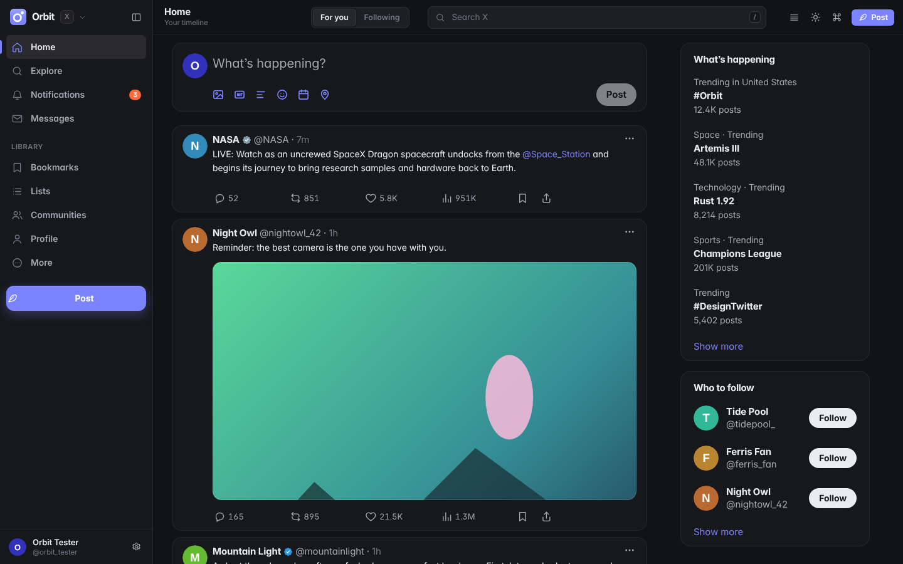
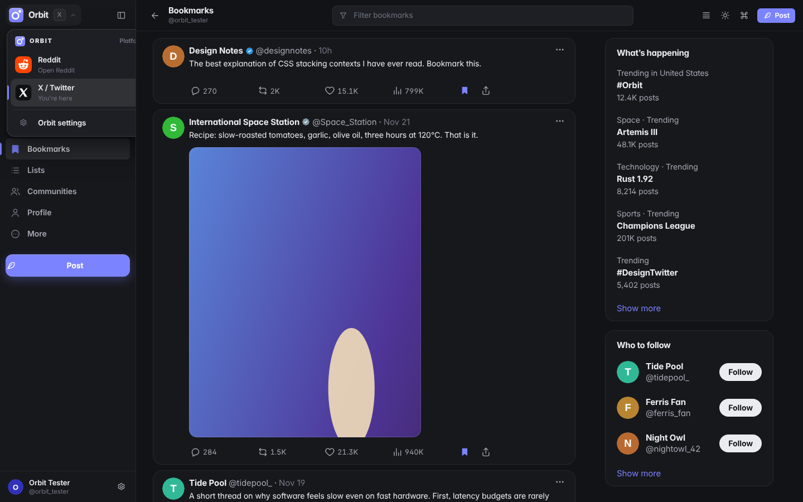
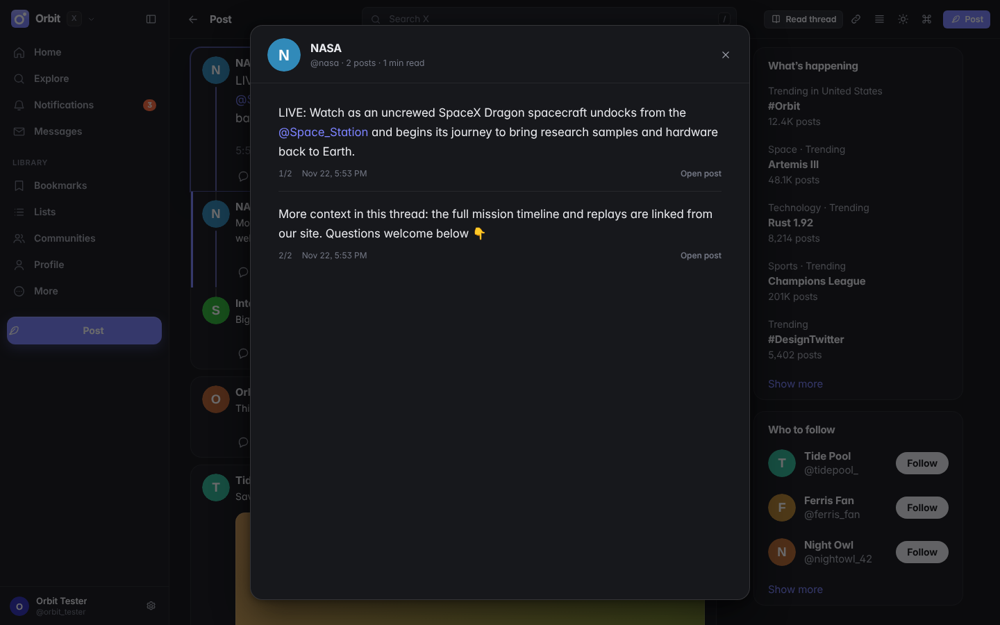
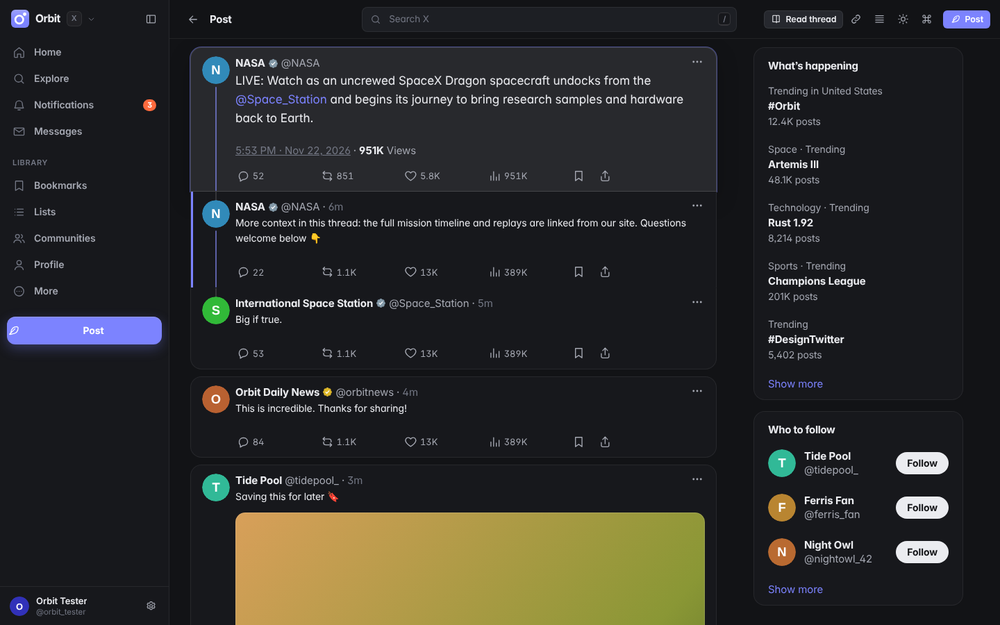
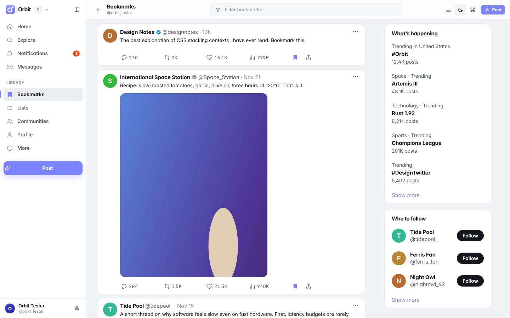
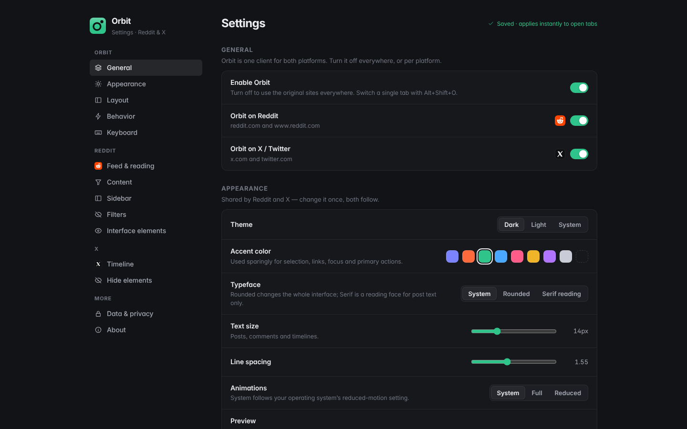

<p align="center"></p>

# Orbit

**One premium, keyboard-first client for Reddit, X and YouTube — built as a Chrome extension.**

*Reddit — communities and discussions. X — real-time conversations. YouTube — video discovery and creators.*

Orbit redesigns Reddit, X (Twitter) and YouTube with one design language: the same typography, palette, spacing, navigation and settings everywhere, while each platform keeps the interactions that make it unique. Click the Orbit logo on any of them to jump to another — Orbit remembers where you were. Everything runs in your browser on top of your existing logins. There is no server and no account to create.

| YouTube — Home | YouTube — Watch page |
|---|---|
|  |  |
| **YouTube — comments** | **YouTube — Shorts** |
|  |  |
| **X — Home timeline** | **Reddit — Home feed** |
|  |  |
| **Platform switcher** | **Thread reader on X** |
|  |  |
| **X — conversation** | **X — light theme** |
|  |  |
| **Reddit — post & comments** | **Unified settings** |
|  |  |

---

## Install

### Option A — load the prebuilt extension (fastest)

1. Download or clone this repository.
2. Open `chrome://extensions` in Chrome (or any Chromium browser: Edge, Brave, Arc).
3. Turn on **Developer mode** (top-right).
4. Click **Load unpacked** and select the **`dist/`** folder.
5. Open [reddit.com](https://www.reddit.com), [x.com](https://x.com) or [youtube.com](https://www.youtube.com). The settings page opens automatically on first install.

You can also unzip `release/orbit-3.0.0.zip` and load that folder the same way.

### Option B — build from source

Requires Node.js 18+.

```bash
npm install
```

```bash
npm run build
```

Then load `dist/` as described above. Use `npm run dev` to rebuild automatically while editing, then click the reload icon on the Orbit card in `chrome://extensions`.

## Updating

- **From source:** `git pull`, then `npm install` and `npm run build`, then click **reload** (↻) on the Orbit card in `chrome://extensions` and refresh open Reddit, X and YouTube tabs.
- **From a zip:** replace the folder you loaded with the new one and click **reload** in `chrome://extensions`.

Settings live in Chrome's synced storage and history in local storage; both survive updates. Upgrading from the earlier Reddit-only release keeps all your existing Reddit settings.

---

## Features

### One product, three platforms
- **Orbit logo + platform switcher** at the top of the navigation on both sites: a compact launcher with Reddit, X and YouTube — each with its icon and a one-line description — the current platform marked, and *Resume · Bookmarks*-style hints. It is one shared component on every site. Fully keyboard-operable (`Alt+O` to open, arrows, `1`/`2`, `Enter`, `Esc`).
- **Switching keeps your place.** Orbit remembers the last page you had open on each platform (log-in pages, composers and media viewers are never remembered) and returns you there in the same tab.
- **Shared settings**: theme (dark/light/system), accent colour, typeface (system, rounded, serif reading face), text size, line spacing, animations (system/full/reduced), sidebar mode and width, content width, density, keyboard shortcuts and "remember where you were" apply to every platform at once. Platform-specific preferences stay separate — Reddit's gallery layout never touches X's timeline or YouTube's video grid.
- **Per-platform switches**: turn Orbit off for one platform, or flip a single tab to the classic site with `Alt+Shift+O`.

### YouTube
- **Orbit navigation** replaces YouTube's guide: Home, Shorts, Subscriptions, Trending, Library, History, Playlists, Your videos, Watch later, Liked videos, your subscribed channels (with new-video dots), Explore and Settings. **Pin** any item to a Pinned section, **hide** items or whole sections, **reorder** sections, **collapse** sections, or collapse the whole sidebar to icons (`\`). Narrow windows get a slide-in drawer. Density follows Orbit's shared setting.
- **Top bar** replaces the masthead: page title, an Orbit search box with YouTube's own suggestions and your recent searches, category chips as a clean segmented row, view options, theme, palette (`Ctrl/⌘+K`), and YouTube's Create, notifications and account menus (still YouTube's own).
- **Home**: a responsive grid that fits as many columns as the window allows for the chosen thumbnail size, polished cards (rounded 16:9 thumbnails, duration pills, channel avatars, titles, channel, views and age, the "More actions" menu), and three layouts — **Comfortable**, **Compact** (more videos, less chrome) and **Editorial** (a featured lead video) — switchable instantly.
- **Watch page**: the player as the centrepiece (framed, three widths: Standard, Wide, Immersive; theater and full screen untouched), a cleaner title / channel / subscribe / like / share / save block, a description card, and **Up next** as a sidebar, a **grid below the player**, or a **compact list**.
- **Comments**: threaded cards with a reply guide line, or a compact layout; clearer authors, creator badges, timestamps, likes and reply toggles; an inviting composer. Optionally collapsed until you click the count.
- **Shorts**: vertical player with rounded framing, an ambient backdrop and dimmed neighbours (Focused), Orbit-styled action buttons; native scrolling, arrows and comments panel untouched.
- **Search**: Orbit search with suggestions and recent searches, YouTube's own filters restyled, and results as clean rows with description previews.
- **Channels, playlists, history, Library, Trending**: Orbit typography, banners, tabs, rows and panels.
- **Never touched**: the video player and its controls, playback (it keeps playing through navigation and theater mode), subscriptions, likes, comments, playlists, history, Premium, sign-in — and **ads, which Orbit never hides or alters**. `m.youtube.com` gets the Orbit theme only.

### X / Twitter
- **Orbit navigation**: Home, Explore, Notifications, Messages, Bookmarks, Lists, Communities, Profile and More, with live unread badges, a primary Post button and your account menu. Collapses to icons (`\`).
- **Top bar**: page title, For you / Following (and any pinned feeds) as a segmented control, X search, contextual actions (Read thread, Copy link), view options, theme toggle and the command palette (`Ctrl/⌘+K`).
- **Timeline redesign**: posts as calm cards (or a classic list) with Orbit typography, rounded media frames, quote cards, repost context, colour-coded engagement (reply, repost, like, bookmark, share), clear keyboard-focus states and hover states.
- **Media without the scroll-jacking**: images and video are capped to a chosen height (compact / balanced / full) while keeping their aspect ratio. Photos open in **Orbit's media viewer** (zoom, pan, arrows, thumbnails, the post caption, open original); shift-click for X's own viewer.
- **Better threads**: on a post page the post itself is highlighted, the author's own thread is marked down the side, reply chains are drawn as one connected card, and **Read thread** (`Shift+R`) unrolls the author's thread into a clean long-form reader.
- **Bookmarks filter**: type to filter loaded bookmarks by text or author.
- **Declutter**: hide promoted posts, view counts, the inline composer, "Who to follow", trends, Premium upsells or the whole right panel.
- **Native where it matters**: posting, replying, quoting, reposting, liking, bookmarking, following, notifications, direct messages, search and log-in are X's own — Orbit drives X's real controls instead of re-implementing them.

### Reddit
- **Collapsible sidebar** with Home, Popular and All, pinned communities, quick-access links, recent communities, your joined communities, and your profile, Saved, Inbox (with unread count) and History. Sections can be reordered, hidden and shown.
- **Top bar**: feed title, search with live community suggestions (scoped to the community you're in), sort menu with time ranges, layout switcher, refresh, theme toggle, inbox bell and account menu.
- **Four feed layouts**: Comfortable, Compact, Gallery and Minimal.
- **Post cards** with community identity, author, age, flair, NSFW/spoiler/locked/pinned tags, link domain, previews for images, galleries, video, embeds and links, voting, comments, share, save and a "more" menu.
- **Threaded comments** that are easy to follow: collapse/expand, load more, keyboard thread navigation, OP highlighting.
- **Media viewer**, **command palette**, **history drawer**, filters (muted communities and keywords), blur for NSFW and spoilers, reading mode and an optional unread badge on the toolbar icon.

### Keyboard shortcuts

**Everywhere:** `Ctrl/⌘ K` command palette · `Alt O` platform switcher · `Alt Shift O` classic site on this tab. **YouTube:** `\` sidebar, `/` search; YouTube's own player keys (`K` `J` `L` `F` `T` `M` `C`) are unchanged.

| Reddit | | X | |
|---|---|---|---|
| `J` / `K` | next / previous post | `\` | collapse / expand sidebar |
| `O` / `Enter` | open post | `Shift+R` | read the whole thread |
| `A` / `Z` | upvote / downvote | `/` | search |
| `S` | save | `←` / `→` | previous / next image in the viewer |
| `1`–`4` | layouts | `J` `K` `L` `R` `T` `B` `N` | X's own shortcuts, unchanged |
| `B` / `T` | sidebar / theme | | |
| `?` | all shortcuts | | |

---

## How it works

```
src/
├── manifest.json            MV3 manifest (storage, alarms; reddit.com, x.com, twitter.com, youtube.com)
├── core/                    the Orbit design system and everything shared
│   ├── tokens.css           design tokens (dark & light) — the single source of colour, type, motion
│   ├── components.css       shared components: sidebar, top bar, buttons, menus, palette, viewer, toasts
│   ├── chrome.css           platform switcher, motion preference
│   ├── Icon.tsx             icon set, Orbit logo, platform icons
│   ├── Switcher.tsx         the Orbit platform switcher (one component for every platform)
│   ├── shell.tsx, shell.css the overlay shell for X and YouTube: Shadow-DOM host, sidebar/top-bar frame,
│   │                        command palette, shortcuts sheet, toasts
│   ├── pageSheet.ts         page-level token sheet + native light/dark sync shared by X and YouTube
│   ├── ui.tsx               menu, popover and keyboard primitives
│   ├── platforms.ts         platform registry & detection, remembered locations, switching
│   ├── settings.ts          shared + per-platform settings schema and storage
│   └── launcher.ts, messages.ts, shortcuts.ts
├── platforms/
│   ├── reddit/              Orbit for Reddit (its own content bundle)
│   │   ├── index.ts         activation, classic mode, SPA navigation
│   │   ├── mount.tsx        React app in a Shadow DOM
│   │   ├── reddit.css       document_start CSS that hides native Reddit before first paint
│   │   └── app/             API client, state, components, views
│   └── x/                   Orbit for X (its own content bundle)
│       ├── index.ts         activation, session detection, update loop, keyboard, media interception
│       ├── dom.ts           the X DOM adapter: every selector Orbit relies on, for both X web clients
│       ├── decorate.ts      marks X's posts, media, threads and rail cards for the skin
│       ├── theme.ts         page-level token sheet: Orbit tokens + X's --x-* tokens re-pointed
│       ├── x.css            the X skin (manifest CSS, gated by html classes)
│       ├── routes.ts        X URL classification
│       └── ui/              Orbit's sidebar, top bar, palette, media viewer and thread reader
│   └── youtube/             Orbit for YouTube (its own content bundle)
│       ├── index.ts         activation, throttled update loop (ignores the player's own DOM churn), grid sizing
│       ├── dom.ts           the YouTube DOM adapter: element names, guide, masthead actions, chips, search
│       ├── theme.ts         Orbit tokens + YouTube's --yt-spec-* / --yt-sys-* tokens re-pointed; grid & watch sizing
│       ├── youtube.css      the YouTube skin (manifest CSS, gated by html classes)
│       ├── routes.ts        YouTube URL classification
│       └── ui/              Orbit's customisable sidebar, top bar (search, chips), view options, palette
├── background/              service worker: defaults, Reddit unread badge, Alt+Shift+O command
├── options/                 unified settings page (Orbit · Reddit · X)
└── popup/                   toolbar popup with platform shortcuts
```

**Two strategies, one look.** Each platform gets the integration that is most robust for it:

- **Reddit** — Orbit renders its own interface from Reddit's stable JSON endpoints inside an isolated Shadow DOM. Reddit can reshuffle its markup without breaking Orbit. Votes, saves and comments use Reddit's standard API with your session's CSRF token.
- **YouTube** — like X, YouTube's own app keeps running so the real player, Premium, subscriptions, comments and history work exactly as before. Orbit re-points YouTube's design tokens at its own, replaces the guide and masthead (the masthead stays in place, invisible, so its account and notification menus keep working when Orbit's buttons open them), mirrors the category chips, sizes the grid by setting YouTube's own items-per-row variable, and restyles everything else with CSS keyed to YouTube's stable custom-element names. The update loop is throttled, skips mutations inside the video player, and never polls.
- **X** — X's data API is private and token-gated, so Orbit does not re-implement it. Instead **X's own app keeps running**, and Orbit lays its design over it: X's current web client is themed through its own semantic CSS variables (`--x-bg-primary`, `--x-fg-*`, `--x-border-*` …), which Orbit re-points at Orbit's tokens, so every X surface — menus, dialogs, DMs, settings — follows Orbit's palette; X's older client is handled by remapping its atomic colour classes at runtime. Orbit replaces X's navigation with its own (in a Shadow DOM), marks posts, media and threads with `data-orbit-*` attributes for the skin, and drives X's real controls (clicking X's own links and buttons) so posting, likes, DMs and navigation stay native and instant.

**Performance.** One `MutationObserver` per page batches work into animation frames; each X post is processed exactly once (reads before writes), nothing is ever rebuilt, and sticky-header docking and rail classification are throttled. Reddit feeds use `content-visibility`, request de-duplication and cached Back navigation. Both suites assert no long tasks while scrolling and paging.

**Your sessions, untouched.** Orbit never reads, stores or modifies cookies or tokens, never touches log-in, sign-up or OAuth pages, never bypasses ads, subscriptions or paywalls, and sends nothing anywhere except to reddit.com, x.com and youtube.com themselves.

## Testing

```bash
npm test
```

This builds the extension, launches Chromium with it loaded, and runs three end-to-end suites:

- **Reddit** (`tests/e2e.mjs`, against `tests/mock-reddit.mjs`, a mock of Reddit's JSON API): activation, feeds, layouts, voting/saving, keyboard, posts and comments, lightbox, search, profiles, inbox, theme persistence, sidebar customisation, classic mode, options live-apply, enable/disable, performance, mobile width, fallbacks and zero console errors.
- **X & switching** (`tests/e2e-x.mjs`, against `tests/mock-x.mjs`, a mock x.com modelled on the markup of X's current web client): chrome replaces native navigation, card restyle and typography, promoted/upsell/view hiding, native like/bookmark/repost and posting through the skin, mirrored feed tabs, SPA navigation across every page type (no reloads), search, post pages with focal/author-thread/connected replies, thread reader, media viewer, X modals stepping above Orbit, bookmark filter, infinite scroll, view options, palette, compact sidebar, shared theme, the platform switcher (mouse and keyboard), X → Reddit → X switching with resume, per-platform settings separation, classic toggle, per-platform disable, signed-out and log-in pages left alone, narrow layout, performance and zero console errors.

- **YouTube & three-way switching** (`tests/e2e-youtube.mjs`, against `tests/mock-youtube.mjs`, a mock youtube.com built from YouTube's current element names with a real playing `<video>`): chrome replaces guide and masthead, token re-pointing, grid columns and card anatomy, ads left visible, chip mirroring, Comfortable/Compact/Editorial switching without reloads, infinite scroll, watch page playback and native like/subscribe, player controls and theater keeping the same playing video, the three Up next layouts, threaded/compact comments with replies and posting, playback surviving navigation (miniplayer), every page type via SPA navigation, channels, search with suggestions/recents/filters/descriptions, Shorts (scrolling, likes, comments panel), sidebar pin/hide/collapse/reorder, compact sidebar, theme, narrow drawer, YouTube's own menus above Orbit, palette, the three-platform switcher, YouTube → X → Reddit → YouTube with resume, classic toggle and per-platform disable, signed-out and m.youtube.com, performance and zero console errors.

Run them separately with `npm run test:reddit` / `npm run test:x` / `npm run test:youtube`. Screenshots land in `test-results/`. Requires Playwright with Chromium. Run `npm run typecheck` for TypeScript and `npm run package` to produce `release/orbit-<version>.zip`.

---

## Limitations

Orbit only implements things that genuinely work. The honest edges:

- **Tested against mocks.** The end-to-end suites run against faithful mocks. For X, the mock follows markup captured from X's current web client; Orbit's X skin was also checked against a real, signed-out x.com page. The signed-in X interface could not be inspected from the build environment, so selectors are written defensively (semantic HTML, ARIA and X's design tokens first; `data-testid` hooks for X's older client) and everything degrades gracefully: if Orbit can't find something, X's own version simply shows. Please open an issue with a screenshot if something on X looks off.
- **X modals** (composer, X's own photo viewer, dialogs) are X's; Orbit re-themes them and steps its chrome behind them while they're open.
- **Signed-out X** gets the Orbit skin but keeps X's own navigation; Orbit's sidebar appears once you're signed in. Log-in, sign-up and OAuth pages are never touched.
- **Reddit pages that aren't redesigned** (settings, post submission, chat, wikis, mod tools…) open in classic Reddit with a button to come back. Reddit's own app loads once (hidden) on the first page of a tab.
- **Fonts**: Orbit uses your system UI font (or the rounded/serif choice) instead of downloading web fonts, which keeps it fast and compatible with both sites' security policies.
- **YouTube** was likewise tested against a mock built from YouTube's current element names (checked against a live youtube.com page). Orbit targets custom-element names, ids and ARIA, which YouTube rarely changes; anything Orbit can't find simply stays YouTube's own. Search suggestions come from YouTube's own search box; if YouTube stops rendering them while hidden, Orbit falls back to your recent searches. Mixes, live chat and YouTube Studio keep YouTube's layout with Orbit's colours.
- **Domains**: `reddit.com`, `www.reddit.com`, `x.com`, `twitter.com` (plus `www.`/`mobile.` variants) and `youtube.com` / `www.youtube.com` (full redesign) / `m.youtube.com` (theme only). `old.reddit.com` is left alone.

## Brand

The Orbit mark is a ring with a satellite — one product, many worlds. It's built from two shapes so it stays crisp at 16 px, and inside the app it follows your accent colour. Source files are in `docs/brand/` (mark plus light and dark wordmarks); `npm run icons` regenerates the extension PNGs.

## Privacy

Orbit has no backend, analytics or tracking. Settings sync through your Chrome profile (`chrome.storage.sync`). History, recent searches, visited posts and the last page per platform stay on your device (`chrome.storage.local`) and can be cleared in Settings → Data & privacy. The only network requests go to reddit.com, x.com, youtube.com and the media hosts they link to. YouTube recent searches made in Orbit's search box stay on this device.
